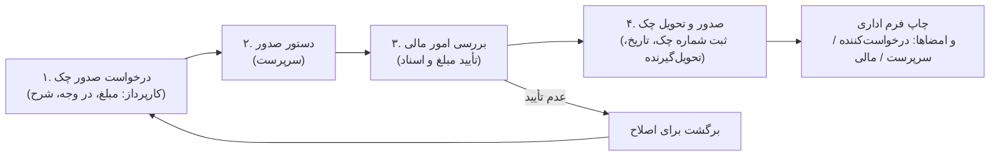
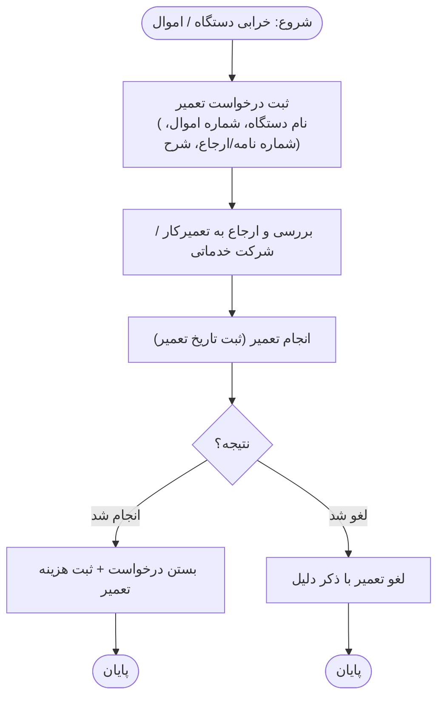
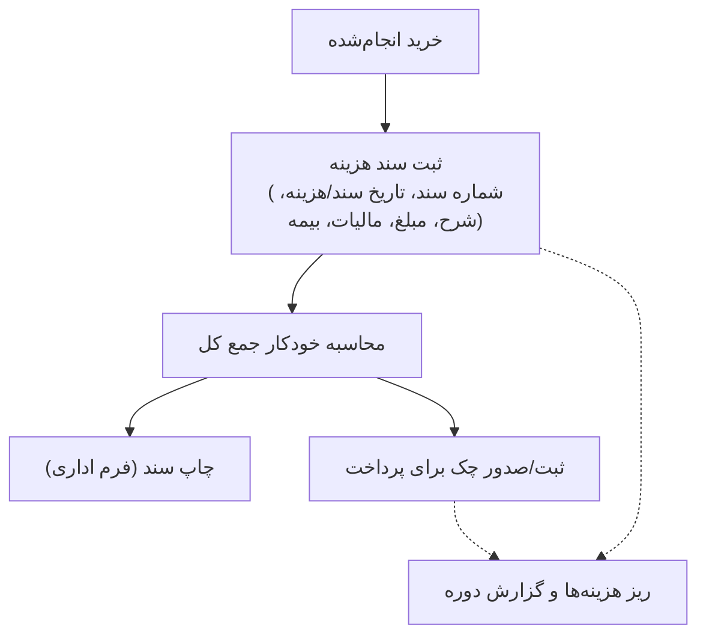
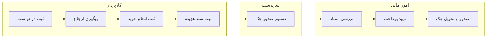
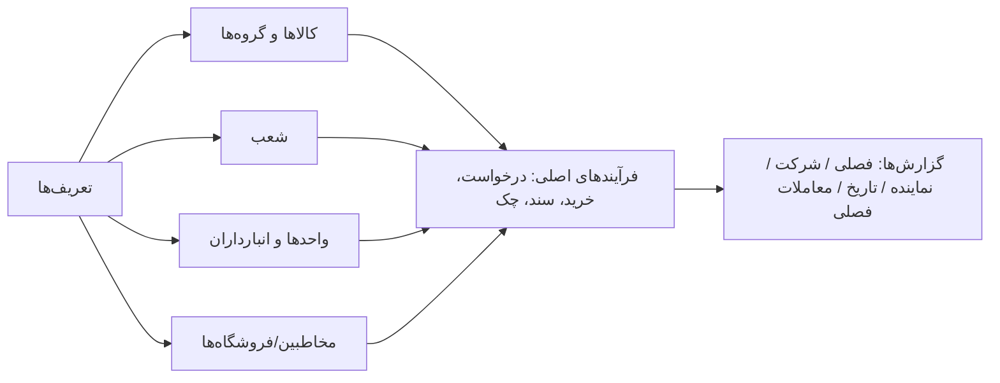

# طرح پیشنهادی سیستم کارپردازی — نسخه تحت شبکه

> وضعیت: **پیش‌نویس برای بررسی شما — هنوز هیچ کدی نوشته نشده**
> پس از تأیید/اصلاح شما، اجرای پروژه آغاز می‌شود.

**فهرست مطالب:** [۱. تحلیل وضع موجود](#۱-برداشت-من-از-فایل-فعلی-تحلیل-وضع-موجود) —
[۲. فلوچارت فرآیندها](#۲-فلوچارت-فرآیندهای-کارپردازی) —
[۳. پیشنهاد فنی](#۳-پیشنهاد-فنی-برای-نسخه-جدید-چون-چند-نفر-همزمان-روی-شبکه-کار-میکنند) —
[۴. امکانات](#۴-امکانات-پیشنهادی-نسخه-جدید-ماژول-به-ماژول) —
[۵. چندنفره بودن](#۵-چندنفره-بودن-روی-شبکه--جزئیات) —
[۶. پیشنهادها](#۶-پیشنهادها-و-نکات-تکمیلی-من) —
[۷. سؤالات](#۷-سؤالهایی-که-قبل-از-شروع-لطفاً-جواب-بدید)

---

## ۱. برداشت من از فایل فعلی (تحلیل وضع موجود)

فایل `کارپردازی مطهری 14030319_2.accdb` یک سیستم **کارپردازی (تأمین کالا/خدمات)** برای
«شرکت انبارهای عمومی و خدمات گمرکی ایران — مجتمع خراسان — شعبه شهید مطهری» است.
من ساختار فایل را استخراج کردم. بخش‌هایی که در برنامه وجود دارد:

### ۱.۱ ماژول‌ها (فرم‌های اصلی)

| # | ماژول | کارهایی که الان انجام می‌دهد |
|---|--------|------------------------------|
| ۱ | **درخواست خرید کالا/خدمات** | ثبت درخواست (تاریخ، شعبه، کد کالا، واحد، مقدار، اولویت، شرح)، ثبت انجام خرید، ثبت گروهی خرید، ویرایش، حذف، لیست درخواست‌ها، جست‌وجو، مانده درخواست‌ها، ارجاعات (صدور/مشاهده)، دریافت نامه، پیوست‌ها، لغو (کنسل) |
| ۲ | **درخواست تعمیر** | ثبت درخواست تعمیر (نام دستگاه، شماره اموال، شماره نامه، شماره ارجاع)، لیست، ویرایش، حذف، لغو تعمیر، تاریخ تعمیر |
| ۳ | **سند هزینه** | ثبت سند جدید (شماره سند، تاریخ سند/هزینه، شرح، مبلغ، مالیات، بیمه، فروشگاه)، لیست اسناد خرید و هزینه، ریز هزینه‌ها، چاپ/چاپ مجدد سند |
| ۴ | **صدور چک** | درخواست صدور چک ← دستور صدور ← بررسی امور مالی ← صدور و تحویل چک (گردش‌کار چندمرحله‌ای با فرم چاپی و امضا: درخواست‌کننده، سرپرست، امور مالی) |
| ۵ | **اموال** | ثبت اموال جدید (شماره اموال، نام اموال/دستگاه، مکان، واحد، تحویل‌گیرنده)، تغییرات و جابجایی، مشاهده سوابق |
| ۶ | **مخاطبین (تلفن)** | ثبت اشخاص/شرکت‌ها/فروشگاه‌ها (نام، نام خانوادگی، تلفن، موبایل، کد ملی، کد اقتصادی، کد پستی، آدرس، گروه)، لیست، جست‌وجو، ویرایش |
| ۷ | **گزارشات** | گزارش خرید فصلی، گزارش بر اساس شرکت، بر اساس نماینده، بر اساس تاریخ، معاملات فصلی، جست‌وجو و چاپ |
| ۸ | **تعریف‌ها (جدول پایه)** | کالا (کد، نام، گروه، واحد)، شعب، گروه‌های کالا، انبارداران، انواع بسته‌بندی، تخفیف صادراتی |
| ۹ | **کاربران** | ورود با نام کاربری/کلمه عبور |
| ۱۰ | **سایر** | پشتیبان‌گیری، اسکن اسناد مالی، صفحه اصلی (شمارنده تعداد درخواست‌ها، تاریخ و ساعت امروز) |

### ۱.۲ جدول‌های داده‌ای که پیدا کردم

- `tbl_darkhast` — درخواست‌های خرید (تاریخ درخواست، شعبه، کد کالا، واحد، مقدار، مقدار مانده، اولویت، شرح، دستگاه، نوع درخواست، اموال، ارجاع، تاریخ خرید، انتخاب/کنسل)
- `tbl_darkhast_tamir` — درخواست‌های تعمیر
- `tbl_main_darkhast` / `tbl_main_darkhast_tamir` — سربرگ درخواست‌ها (شماره/نامه)
- `tbl_sanad_hazine` — اسناد هزینه (شماره سند، تاریخ سند، تاریخ هزینه، شرح، مبلغ، مالیات، بیمه، در وجه، فروشگاه)
- `tbl_check` — چک‌ها (شماره چک، مبلغ، تاریخ ثبت، شرح، سند مرتبط)
- `tbl_kala_name` — کالاها (کد کالا، نام، گروه)
- `tbl_shobe` — شعب (مطهری، مشهد، فرودگاه، لطف‌آباد، سرخس، دوغارون، نیشابور، گمرک)
- `tbl_amval` — اموال (شماره اموال، نام، دستگاه، مکان، واحد، تحویل‌گیرنده)
- `tbl_tel` — مخاطبین
- `tbl_user` — کاربران
- `tbl_tarefe`، `tbl_sorathesab`، `tbl_sharh_tamir` — تعرفه، صورت‌حساب، شرح‌های تعمیر
- جدول‌های موقت `tbl_temp_*` برای ثبت گروهی

**نکته:** فرم‌های چاپی رسمی (درخواست چک، سند، نامه‌ها) با سربرگ «امام خمینی(ره) — مجتمع خراسان» و امضاهای کارپرداز/سرپرست/امور مالی در فایل موجود است که در نسخه جدید بازسازی می‌شوند.

---

## ۲. فلوچارت فرآیندهای کارپردازی

### ۲.۱ فلوچارت کلی فرآیند خرید (از نیاز تا پرداخت)

این فلوچارت گردش اصلی کار است که از فرم‌های فایل Access استخراج شده و در نسخه جدید هم عیناً پیاده می‌شود:

```mermaid
flowchart TD
    A(["شروع: اعلام نیاز واحد / شعبه"]) --> B["ثبت درخواست خرید کالا/خدمات<br/>(تاریخ، شعبه، کد کالا، واحد، مقدار، اولویت، شرح)"]
    B --> C{"کنسل شود؟"}
    C -- "بله" --> C1["بستن درخواست با ذکر دلیل"] --> END1(["پایان - لغو شد"])
    C -- "خیر" --> D["صدور ارجاع / دریافت نامه<br/>(شماره نامه، پیوست‌ها، ثبت اقدامات)"]
    D --> E["بررسی و انتخاب تأمین‌کننده / فروشگاه"]
    E --> F["ثبت انجام خرید<br/>(تکی یا گروهی - تاریخ خرید - مقدار خریداری‌شده)"]
    F --> G{"مقدار مانده > 0 ؟"}
    G -- "بله (خرید ناقص)" --> F
    G -- "خیر (خرید کامل)" --> H["ثبت سند هزینه<br/>(شماره سند، مبلغ، مالیات، بیمه، فروشگاه)"]
    H --> I["درخواست صدور چک"] --> J --> K --> L --> M --> END2
    subgraph CHECK [ "گردش‌کار چک (جزئیات در فلوچارت ۲.۲)" ]
        J["دستور صدور - سرپرست"]
        K["بررسی امور مالی"]
        L["صدور و تحویل چک"]
        M["ثبت شماره چک + چاپ فرم"]
    end
    END2(["پایان - پرداخت انجام شد"])
    M -.-> N["گزارش‌ها و بایگانی<br/>(خرید فصلی، معاملات فصلی، ریز هزینه‌ها)"]
```

### ۲.۲ گردش‌کار صدور چک (چهار مرحله تأیید — مثل فرم‌های فعلی)



### ۲.۳ فلوچارت درخواست تعمیر



### ۲.۴ فلوچارت سند هزینه و ارتباط اسناد



### ۲.۵ نقش‌ها در فرآیند (شناور چه کسی چه کاری می‌کند)



### ۲.۶ اطلاعات پایه (پیش‌نیاز فرآیندها)



> نسخه متنی ساده فلوچارت کلی (برای کسانی نمودار رندر نمی‌شود):
>
> ```text
> اعلام نیاز ← ثبت درخواست خرید ← (کنسل؟) ← صدور ارجاع/نامه ← انتخاب تأمین‌کننده
>      ← ثبت انجام خرید ← آیا مانده دارد؟(تکرار) ← ثبت سند هزینه
>      ← درخواست چک ← دستور سرپرست ← بررسی مالی ← صدور و تحویل چک ← گزارش/بایگانی
> ```

---

## ۳. پیشنهاد فنی برای نسخه جدید (چون چند نفر هم‌زمان روی شبکه کار می‌کنند)

### ۳.۱ گزینه‌ها

| گزینه | توضیح | مناسب برای |
|-------|--------|------------|
| **الف) وب‌اپ داخلی (پیشنهاد من)** — Python + Streamlit + SQLite | یک سیستم میزبان در شبکه داخلی برنامه را اجرا می‌کند؛ بقیه با مرورگر وصل می‌شوند. نصب و نگهداری ساده. | تا حدود ۱۰ کاربر هم‌زمان — برای «چند نفر» کاملاً کافی |
| ب) وب‌اپ + پایگاه داده PostgreSQL | مثل الف ولی با دیتابیس قوی‌تر | اگر بعداً کاربران زیاد یا حجم تراکنش بالا برود |
| ج) دسکتاپ ویندوز (مثل خود Access) | نصب روی هر سیستم + فایل مشترک روی شبکه | ❌ توصیه نمی‌کنم: مشکل قفل فایل و خرابی هم‌زمان مثل خود Access دارد |

**پیشنهاد:** گزینه «الف» را الان بسازیم. ساختار برنامه طوری نوشته می‌شود که بعداً با تغییر یک تنظیم، به PostgreSQL (گزینه ب) منتقل شود — بدون بازنویسی.

### ۳.۲ چرا وب‌اپ بهتر از Access برای چند کاربر است؟

- ❌ Access: هر کاری با فایل `.accdb` معمولاً یک نفر باز می‌کند و بقیه فقط Read-only می‌شوند یا فایل خراب می‌شود.
- ✅ نسخه جدید: همه هم‌زمان کار می‌کنند، هر تغییری فوراً برای بقیه قابل مشاهده است، قفل و تداخل نداریم.
- ✅ بدون نیاز به نصب Microsoft Access روی سیستم کاربران.
- ✅ از هر دستگاهی داخل شبکه (حتی تبلت/موبایل) باز می‌شود.
- ✅ گذرواژه‌ها هش می‌شوند (در فایل Access رمزها ساده ذخیره می‌شوند)، ورود/خروج و هر تغییری لاگ می‌شود.

### ۳.۳ معماری کلی

```
سیستم میزبان (یک کامپیوتر مورد اعتماد داخل شبکه)
   └── برنامه وب (Streamlit) ─── پایگاه داده SQLite (فایل محلی روی همان میزبان)
              ▲
              │  مرورگر (http://IP-داخلی:پورت)
   ┌──────────┼──────────┐
 کاربر۱    کاربر۲    کاربر۳ ...
```

- داده‌ها فقط روی دیسک میزبان ذخیره می‌شود (به NAS اشتراکی نمی‌دهیم تا خرابی رخ ندهد).
- پشتیبان‌گیری خودکار روزانه + پشتیبان‌گیری دستی توسط مدیر.
- پورت فقط برای شبکه داخلی باز می‌شود؛ به اینترنت منتشر نمی‌شود.

---

## ۴. امکانات پیشنهادی نسخه جدید (ماژول به ماژول)

### ۴.۱ ورود و کاربران
- ورود با نام کاربری و گذرواژه (هش‌شده با PBKDF2)
- نقش‌ها:
  - **مدیر:** همه‌چیز + مدیریت کاربران + پشتیبان‌گیری + حذف
  - **کارپرداز:** ثبت/ویرایش درخواست‌ها، خرید، اموال، مخاطبین
  - **مالی:** اسناد هزینه، چک‌ها، گزارش‌های مالی
  - **فقط‌خواندنی:** مشاهده لیست‌ها و گزارش‌ها
- قفل موقت حساب بعد از چند ورود ناموفق
- محدودیت دسترسی هر کاربر به شعبه (اختیاری)

### ۴.۲ صفحه اصلی (داشبورد)
- شمارنده‌ها: تعداد درخواست‌های باز، مانده درخواست‌ها، چک‌های در انتظار، درخواست‌های امروز
- تاریخ و ساعت امروز (شمسی)
- دسترسی سریع به ثبت‌های پرکاربرد

### ۴.۳ درخواست خرید کالا/خدمات
- ثبت سربرگ درخواست + چند ردیف کالا/خدمت در یک درخواست
- فیلدها: شماره درخواست/نامه، تاریخ درخواست (شمسی)، شعبه، کد کالا (با جست‌وجو)، نام کالا، واحد، مقدار، اولویت (عادی/فوری/...)، شرح، توضیحات
- **ثبت انجام خرید** (تکی یا گروهی) با تاریخ خرید و مقدار خریداری‌شده — محاسبه خودکار «مقدار مانده»
- ارجاعات: صدور ارجاع، مشاهده ارجاعات، شماره نامه، پیوست‌ها
- لغو/کنسل درخواست با ذکر دلیل
- لیست درخواست‌ها با فیلتر (تاریخ، شعبه، کالا، وضعیت) و جست‌وجو + خروجی Excel/چاپ
- مانده درخواست‌ها (درخواست‌هایی که هنوز کامل خرید نشده‌اند)

### ۴.۴ درخواست تعمیر
- ثبت: نام دستگاه، شماره اموال (اتصال به جدول اموال)، شماره نامه/ارجاع، شرح تعمیر، تاریخ درخواست، اولویت
- وضعیت‌ها: در انتظار ← در حال تعمیر ← انجام‌شده / لغوشده
- لیست، ویرایش، حذف، خروجی و چاپ

### ۴.۵ سند هزینه
- ثبت سند: شماره سند، تاریخ سند، تاریخ هزینه، شرح هزینه، مبلغ، مالیات، بیمه، فروشگاه/طرف حساب
- محاسبه خودکار جمع کل (مبلغ + مالیات + بیمه)
- لیست اسناد + جست‌وجو + ریز هزینه‌ها + جمع دوره
- **فرم چاپی سند** مطابق نمونه فعلی (سربرگ رسمی، محل امضا)

### ۴.۶ صدور چک (گردش‌کار چهارمرحله‌ای — مثل همان فرم‌های فعلی)
1. **درخواست صدور چک** (درخواست‌کننده: مبلغ، در وجه، شرح، تاریخ درخواست)
2. **دستور صدور** (سرپرست)
3. **بررسی امور مالی** (توضیحات بررسی، تأیید مبلغ)
4. **صدور و تحویل چک** (شماره چک، تاریخ صدور، تحویل‌گیرنده) ← فرم چاپی نهایی
- چاپ فرم‌های «درخواست صدور چک» و «دستور صدور چک» دقیقاً با متن‌های اداری فعلی
- ثبت/ویرایش چک‌ها (شماره چک، مبلغ، تاریخ بازنگری، شرح چک) + پیوند با سند هزینه

### ۴.۷ اموال
- ثبت اموال جدید: شماره اموال، نام اموال، نام دستگاه، مکان، واحد، تحویل‌گیرنده
- جابجایی/تغییرات (تاریخ، از کجا به کجا، تحویل‌دهنده/گیرنده) با تاریخچه کامل سوابق
- جست‌وجو و گزارش اموال هر واحد/مکان

### ۴.۸ مخاطبین
- ثبت شخص / شرکت / فروشگاه: نام، نام خانوادگی، نام شرکت، نام فروشگاه، تلفن، موبایل، کد ملی، کد اقتصادی، کد پستی، آدرس، گروه، توضیحات
- لیست همه مخاطبین / فقط اشخاص، جست‌وجو، ویرایش، چاپ

### ۴.۹ گزارشات
- گزارش خرید فصلی (بهار/تابستان/پاییز/زمستان)
- گزارش بر اساس شرکت/فروشگاه
- گزارش بر اساس نماینده/تحویل‌گیرنده
- گزارش بر اساس بازه تاریخ
- معاملات فصلی (برای اظهارنامه مالیاتی)
- نمودار خرید ماهانه/فصلی
- خروجی Excel و چاپ همه گزارش‌ها

### ۴.۱۰ تعریف‌ها
- کالاها (کد، نام، گروه، واحد) + گروه‌های کالا (لوازم و قطعات، مواد مصرفی ماشین‌آلات، لوازم اداری، ...)
- شعب (مطهری، مشهد، فرودگاه، لطف‌آباد، سرخس، دوغارون، نیشابور، گمرک — قابل افزودن)
- واحدها، انبارداران، انواع بسته‌بندی، تعرفه/تخفیف صادراتی

### ۴.۱۱ مدیریت سیستم
- پشتیبان‌گیری خودکار روزانه + پشتیبان دستی (یک فایل قابل نگهداری)
- سابقه تغییرات (چه کسی، چه چیزی، چه زمانی)
- ورود/خروج کاربران

---

## ۵. چندنفره بودن روی شبکه — جزئیات

| موضوع | راه‌حل |
|-------|--------|
| هم‌زمانی چند کاربر | پایگاه داده در حالت WAL؛ نوشتن‌ها صف‌بندی می‌شوند؛ برای «چند نفر» کندی محسوس ندارد |
| تداخل ویرایش | ویرایش رکورد همان لحظه ثبت می‌شود؛ نمایش «آخرین تغییر توسط چه کسی/چه زمانی» |
| دیدن تغییرات دیگران | داده‌ها زنده است؛ با رفرش صفحه همه آخرین وضعیت را می‌بینند |
| امنیت شبکه | فقط روی شبکه داخلی؛ پورت به اینترنت باز نمی‌شود؛ توصیه به فعال‌سازی رمزنگاری دیسک میزبان |
| خرابی میزبان | پشتیبان خودکار روزانه؛ در صورت نیاز روی سیستم دیگر بازیابی می‌شود |
| مقیاس آینده | اگر کاربران بیشتر شد، مهاجرت به PostgreSQL بدون تغییر ظاهر برنامه |

---

## ۶. پیشنهادها و نکات تکمیلی من

1. **انتقال داده‌های فعلی Access:** می‌توانم داده‌های جدول‌های درخواست‌ها، اسناد، چک‌ها، کالاها، مخاطبین و اموال را استخراج و وارد نسخه جدید کنم تا از صفر شروع نکنید. (فرم‌ها و کدهای VBA قابل انتقال نیستند — منطقشان بازنویسی می‌شود.)
   **⚠ نکته مهم (نتیجه بررسی ساختار):** فایل موجود در گیت‌هاب فقط «فرانت‌اند» (فرم‌ها و کوئری‌ها) است؛ جدول‌های اصلی و داده‌ها در فایل بک‌اند `کارپردازی مطهری 14030319_be.accdb` روی مسیر شبکه `\\10.9.0.3\gomrok\karpardazi\` قرار دارد. برای انتقال داده، لطفاً آن فایل بک‌اند را هم بارگذاری کنید. جزئیات: [سند بررسی ساختار](STRUCTURE-karperdazi.md)
2. **تاریخ‌ها همه شمسی** با انتخابگر تاریخ فارسی؛ میلادی فقط برای خروجی‌های خاص.
3. **چاپ‌ها:** پیشنهاد می‌کنم نسخه اول چاپ‌ها «خیلی نزدیک» به فرم‌های فعلی باشد ولی عیناً یکی نباشد تا بعد از دیدن نسخه اولیه، اصلاحات ظریف (محل امضاها، فاصله‌ها) را با هم نهایی کنیم.
4. **ساده نگه داشتن نسخه اول:** پیشنهاد می‌کنم فازبندی کنیم تا زودتر قابل استفاده شود:
   - **فاز ۱:** ورود کاربران + تعریف‌ها (کالا/شعبه) + درخواست خرید + لیست/جست‌وجو/گزارش پایه
   - **فاز ۲:** انجام خرید، درخواست تعمیر، مانده درخواست‌ها
   - **فاز ۳:** سند هزینه + گردش‌کار چک + چاپ‌ها
   - **فاز ۴:** اموال، مخاطبین، گزارش‌های پیشرفته/معاملات فصلی
5. **اتصال به Excel:** خروجی Excel همه لیست‌ها + ورود گروهی از Excel (چون کاربران فعلی با Excel کار می‌کنند).
6. **پیشنهاد آینده:** امکان الصاق فایل اسکن اسناد به هر درخواست/سند (جایگزین «اسکن اسناد مالی» فعلی).

---

## ۷. سؤال‌هایی که قبل از شروع لطفاً جواب بدید

1. **تعداد کاربران هم‌زمان** تقریباً چند نفر؟ (اگر زیر ۱۰ نفر باشد همین SQLite کافی است.)
2. **انتقال داده‌های فعلی Access** انجام شود یا از صفر شروع کنیم؟
3. **گردش‌کار چک** دقیقاً همان چهار مرحله فعلی باشد؟ (درخواست → دستور سرپرست → بررسی مالی → صدور و تحویل)
4. **فرم‌های چاپی** باید عیناً شبیه نسخه فعلی (با سربرگ و متون اداری) باشند؟
5. **شعبه‌ها و گروه‌های کالا** همین فهرست‌های فعلی کافی است؟
6. آیا به **بخش‌های جدیدی** که الان نیست نیاز دارید؟ (مثلاً موجودی انبار، استعلام قیمت، تأیید سلسله‌مراتبی درخواست)
7. **سیستم میزبان:** یک کامپیوتر مشخص داخل شبکه دارید که برنامه روی آن اجرا شود؟ (ویندوز یا لینوکس؟)

---

## ۸. خلاصه یک‌خطی پیشنهاد

> ساخت یک **وب‌اپ فارسی راست‌چین تحت شبکه داخلی** با همان ماژول‌ها و **فلوچارت‌های فرآیند فعلی** (درخواست خرید ← ارجاع ← انجام خرید ← سند هزینه ← گردش‌کار چک ← گزارش) که چند کاربر هم‌زمان با نقش‌های مختلف از مرورگر استفاده کنند، با پشتیبان‌گیری خودکار، لاگ تغییرات، خروجی Excel و فرم‌های چاپی اداری — و امکان انتقال داده‌های فعلی فایل Access.

---

*لطفاً نظرات، اصلاحات و اولویت‌هایتان را بگویید تا نسخه نهایی طرح را بر اساس آن تنظیم و سپس اجرا کنم.*
