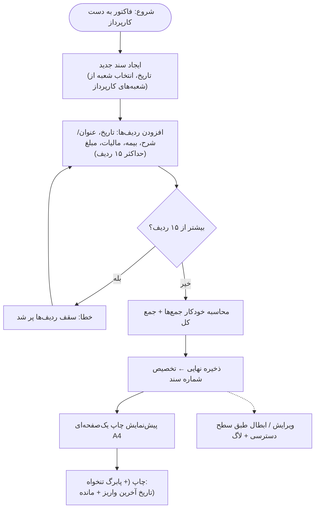
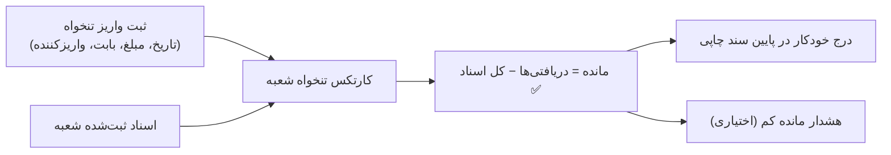

# نیازمندی‌های نهایی — سیستم ثبت و چاپ سند کارپردازی

> وضعیت: **نهایی ✅ — اجرا آغاز شد** (همه سؤال‌ها پاسخ داده شد)
> مبنای چیدمان چاپ: نمونه واقعی `405001.pdf` (سند هزینه شعبه شهید کاوه — تاریخ ۱۴۰۵/۰۷/۱۸)

---

## ۱. نیازمندی‌های قطعی‌شده ✅

| # | نیازمندی | وضعیت |
|---|----------|--------|
| ۱ | ثبت سند/فاکتور با حداکثر **۱۵ ردیف** | ✅ + جزئیات ردیف‌ها از نمونه (بخش ۲) |
| ۲ | چاپ دقیقاً **یک صفحه A4** | ✅ (نمونه هم یک صفحه A4 است) |
| ۳ | شعب قابل افزودن با **کد دو رقمی** | ✅ |
| ۴ | شماره سند = **کد شعبه + سال + عدد متوالی** با ریست سالانه | ✅ (قالب دقیق در بخش ۳) |
| ۵ | رابطه کارپرداز ↔ شعبه **چند-به-چند** | ✅ |
| ۶ | تنخواه: ثبت دریافتی + درج **تاریخ آخرین واریز** و **مانده تنخواه** در انتهای سند چاپی | ✅ |
| ۷ | فرمول مانده تنخواه = **مجموع دریافتی‌ها − مجموع کل اسناد (مبلغ+بیمه+مالیات)** | ✅ |
| ۸ | واحد پول: **ریال** (طبق سرستون «مبلغ به (ریال)» در نمونه) | ✅ از نمونه |
| ۹ | دسترسی‌های مختلف ویرایش/ابطال + لاگ + کاربران + بکاپ خودکار + لوگو/تنظیمات چاپ | ✅ |

---

## ۲. تحلیل کامل نمونه `405001.pdf` (مبنای چیدمان چاپ)

نمونه یک صفحه A4 به نام **«سند هزینه شعبه»** است. ساختار استخراج‌شده:

### ۲.۱ سربرگ

| بخش | محتوا |
|-----|--------|
| راست بالا | نام شرکت: «شرکت انبارهای عمومی و خدمات گمرکی ایران» / «مجتمع خراسان» |
| راست، زیر نام شرکت | «ش ملی: 10100351070» و «کد اقتصادی: 411111361641» |
| وسط (لوگو) | **لوگوی شرکت** ✅ (تصویر از داخل PDF استخراج شد → `docs/sample-logo-from-405001.png`) |
| وسط، زیر لوگو | **نام شعبه** (در نمونه: «شهید کاوه») |
| وسط | عنوان سند: **«سند هزینه شعبه»** |
| چپ بالا | «تاریخ: 1405/07/18» و «شماره سند: 405-001» |
| چپ، زیر تاریخ | «تاریخ بازنگری: 1398/04/26» + کد مدرک «GEN/FI/MH/01» |

### ۲.۲ جدول اقلام (ستون‌ها از راست به چپ)

| ردیف | تاریخ | شرح هزینه (عنوان) | بیمه | مالیات | مبلغ |
|:----:|:-----:|:-----------------:|:----:|:------:|:----:|
| ۱ (خودکار) | ۱۴۰۵/۰۷/۱۸ | … | ۰ | ۰ | ۵,۰۰۰,۰۰۰,۰۰۰ |
| ۲ | ۱۴۰۵/۰۷/۱۸ | … | ۰ | ۰ | ۱۰۰,۰۰۰ |
| — | | **جمع کل** | ۰ | ۰ | … |

- سه ستون پولی زیر سرستون گروهی **«مبلغ به (ریال)»** قرار دارند.
- **ردیف «جمع کل»** در پایان جدول (خودکار).
- ⚠ طبق نمونه، هر ردیف **تاریخ مخصوص به خود** را هم دارد (علاوه بر تاریخ سند در سربرگ).

### ۲.۳ متن استاندارد زیر جدول
> «کلیه موارد فوق با رعایت صرفه و صلاح شرکت و با کمترین بهای ممکن و بهترین کیفیت انجام گرفت.» + **امضاء کارپرداز**

### ۲.۴ چهار بخش گردش‌کار چک/تنخواه (پایین صفحه)

| بخش | محتوا | امضاها |
|-----|--------|--------|
| **درخواست صدور چک تنخواه** | «احتراماً خواهشمند است در خصوص صدور چک تنخواه شماره … در وجه اینجانب … دستور اقدام مقتضی صادر فرمایند.» | امضاء کارپرداز + تاریخ |
| **بررسی امور مالی** | «اسناد و مدارک مربوطه شامل تعداد … برگ به مبلغ کل … ریال بررسی گردید.» + «شرح بررسی …» | کارشناس حسابداری، مسئول حسابداری، مسئول امور کارکنان (+ تاریخ‌ها) |
| **دستور صدور چک** | «امور مالی با پرداخت مبلغ … ریال موافقت می‌شود» | مدیریت، رئیس مالی و اداری، اداری مالی (+ تاریخ‌ها) |
| **صدور و تحویل چک** | «چک شماره … به مبلغ … ریال بتاریخ / / … جاری … بانک … در وجه … صادر و تحویل گردید.» | دریافت‌کننده، امور مالی (+ تاریخ‌ها) |

### ۲.۵ فوتر (ردیف پایین صفحه)
`شماره سند حسابداری | معاملات فصلی | نمره اسناد | اسکن اسناد مالی | توضیحات قابل بررسی`

### ۲.۶ نقشه صفحه (از بالا به پایین)
```text
┌──────────────────────────────────────────────────────────────────────┐
│ شرکت انبارهای عمومی و خدمات گمرکی ایران    [لوگو]    تاریخ: 1405/07/18   │
│ مجتمع خراسان                               سند هزینه شعبه  شماره: 405-001 │
│ ش ملی: …    کد اقتصادی: …        [شهید کاوه]      تاریخ بازنگری/کد مدرک  │
├──────┬──────────┬──────────────────┬─────────┬─────────┬───────────────┤
│ ردیف │  تاریخ   │   شرح هزینه      │  بیمه   │ مالیات  │ مبلغ (ریال)   │
│  ۱   │ 1405/…   │   …              │   ۰     │   ۰     │ 5,000,000,000 │
│  ۲   │ 1405/…   │   …              │   ۰     │   ۰     │ 100,000       │
│      │          │      جمع کل      │   ۰     │   ۰     │ …             │
├──────┴──────────┴──────────────────┴─────────┴─────────┴───────────────┤
│ «کلیه موارد فوق با رعایت صرفه و صلاح شرکت…»            امضاء کارپرداز   │
├─────────────────────────────┬─────────────────────────────────────────┤
│ درخواست صدور چک تنخواه      │        بررسی امور مالی                   │
│ (متن + امضاء کارپرداز)      │ (شرح بررسی + ۳ امضا)                     │
├─────────────────────────────┼─────────────────────────────────────────┤
│ دستور صدور چک               │        صدور و تحویل چک                   │
│ (مدیریت، رئیس مالی/اداری)   │ (دریافت کننده، امور مالی)                │
├──────────────────────────────┴────────────────────────────────────────┤
│ [جعبه تنخواه — پایین سمت راست: تاریخ آخرین واریز + مانده + امضا]       │
├──────────────────────────────────────────────────────────────────────┤
│ شماره سند حسابداری │ معاملات فصلی │ نمره اسناد │ اسکن اسناد │ توضیحات   │
└──────────────────────────────────────────────────────────────────────┘
```

---

## ۳. قواعد شماره‌گذاری سند

**طبق فرمول شما:** `کدشعبه(دو رقمی) - سال شمسی - عدد متوالی` → مثال: `45-1405-0007`

| قاعده | وضعیت |
|-------|--------|
| کد شعبه | **دو رقمی** ✅ |
| ریست سالانه | با شروع سال جدید، عدد متوالی هر شعبه از ۱ ✅ |
| فرمت عدد | ۴ رقمی با صفر ابتدایی (0001) — قابل تنظیم |
| ⚠ تفاوت با نمونه | نمونه فعلی «405-001» چاپ شده (بدون سال) — قالب جدید طبق فرمول شما «کد-سال-عدد» است؟ **سؤال شماره ۳ پایین** |
| زمان تخصیص شماره | هنگام ذخیره نهایی (سند نیمه‌کاره شماره نمی‌سوزاند) |
| هم‌زمانی | تخصیص شماره در وضعیت قفل‌شده (transaction) — بدون شماره تکراری |
| سند باطل‌شده | شماره سوخته می‌ماند + علامت «باطل» + دلیل ابطال |
| شروع از شماره خاص | مدیر بتواند «شماره بعدی» هر شعبه/سال را تنظیم کند |

---

## ۴. فلوچارت فرآیندها

### ۴.۱ ثبت تا چاپ سند



### ۴.۲ گردش تنخواه



---

## ۵. ساختار داده پیشنهادی

| جدول | ستون‌های اصلی | توضیح |
|------|--------------|-------|
| **branches** (شعب) | id، code (دو رقمی یکتا)، name، is_active | نام شعبه در سربرگ چاپ |
| **users** (کاربران) | id، username، password_hash، full_name، role، is_active | رمز هش‌شده |
| **user_branch** | user_id، branch_id | **چند-به-چند** ✅ |
| **documents** (اسناد) | id، doc_number، branch_id، year، seq، doc_date، status (پیش‌نویس/نهایی/باطل)، created_by، voided_by، void_reason، print_count | شماره یکتا |
| **doc_items** (ردیف‌ها) | id، doc_id، row_no، **item_date** ✅ (طبق نمونه)، title، insurance، tax، amount | حداکثر ۱۵ ردیف |
| **tanakhah_tx** (تنخواه) | id، branch_id، tx_date، amount، description، created_by | واریزهای تنخواه |
| **settings** | logo (پیش‌فرض: لوگوی استخراج‌شده از نمونه)، نام شرکت/مجتمع، ش ملی، کد اقتصادی، کد/تاریخ بازنگری مدرک، متن‌های ثابت فرم، قالب شماره، گزینه‌های چاپ | همه قابل ویرایش توسط مدیر |
| **audit_log** | id، user_id، action، entity، entity_id، details (قبل/بعد)، created_at | |

---

## ۶. سطوح دسترسی پیشنهادی

| نقش | ثبت سند | ویرایش سند خودش | ویرایش/ابطال همه | تنخواه | کاربران/تنظیمات/بکاپ | گزارش‌ها |
|-----|---------|-----------------|------------------|--------|---------------------|----------|
| **مدیر سیستم** | ✅ | ✅ | ✅ | ✅ | ✅ | ✅ |
| **سرپرست/مالی** | ✅ | ✅ | ✅ (با مهلت) | ✅ | ❌ | ✅ |
| **کارپرداز** | ✅ (شعبه‌های خودش) | ✅ (تا قبل از مهلت/نهایی) | ❌ | فقط مشاهده | ❌ | ✅ (اسناد خودش) |
| **ناظر** | ❌ | ❌ | ❌ | ❌ | ❌ | ✅ |

---

## ۷. ✨ امکانات پیشنهادی بیشتر

### الف) اسناد و چاپ
| # | امکان | توضیح |
|---|-------|--------|
| ۱ | جمع خودکار (مبلغ/بیمه/مالیات/جمع کل) | مطابق ردیف «جمع کل» نمونه |
| ۲ | **مبلغ به حروف** در چاپ | استاندارد اسناد مالی |
| ۳ | **QR شماره سند** | پیگیری سریع |
| ۴ | پیش‌نمایش چاپ + **چاپ مجدد** + شمارنده چاپ | |
| ۵ | کپی سند (از سند قبلی) | فاکتورهای تکراری |
| ۶ | گزینه چاپ روی سربرگ از پیش‌چاپ‌شده (بدون لوگو/سربرگ) | |
| ۷ | هشدار طول عنوان (حفظ «یک‌صفحه‌ای») | |
| ۸ | تعداد نسخ چاپی قابل تنظیم | |
| ۹ | میانبرهای کیبورد (Enter=ردیف جدید، Ctrl+S، Ctrl+P) | سرعت کار |
| ۱۰ | واترمارک «پیش‌نویس» روی چاپ سند نهایی‌نشده | |

### ب) تنخواه
| # | امکان |
|---|-------|
| ۱۱ | کارتکس تنخواه هر شعبه (دریافت‌ها، مصرف، مانده) |
| ۱۲ | هشدار مانده کم (آستانه قابل تنظیم) |
| ۱۳ | گزارش مقایسه‌ای تنخواه شعب |
| ۱۴ | ویرایش واریز تنخواه فقط با مجوز خاص + لاگ |

### ج) جست‌وجو و گزارش
| # | امکان |
|---|-------|
| ۱۵ | فیلتر: بازه تاریخ، شعبه، شماره سند، عنوان، مبلغ، وضعیت |
| ۱۶ | خروجی Excel و PDF |
| ۱۷ | گزارش ماهانه/فصلی/سالانه شعب |
| ۱۸ | گزارش معاملات فصلی (فیلد «معاملات فصلی» در فوتر نمونه هست) |
| ۱۹ | داشبورد ساده (اسناد امروز/ماه، جمع مبالغ، مانده تنخواه شعب) |

### د) امنیت و نگهداری
| # | امکان |
|---|-------|
| ۲۰ | مهلت ویرایش سند نهایی (مثلاً ۲۴ ساعت/۷ روز؛ بعد از آن فقط مدیر) |
| ۲۱ | ابطال اجباری با دلیل |
| ۲۲ | لاگ کامل (مقادیر قبل/بعد) |
| ۲۳ | بکاپ خودکار روزانه + نگهداری N نسخه + بازیابی |
| ۲۴ | هش رمز، قفل ورود ناموفق، خودکارخروج |
| ۲۵ | سال مالی: بستن/آرشیو سال + ریست شماره‌ها |

### ه) آینده
- الصاق اسکن فاکتور به سند (فیلد «اسکن اسناد مالی» در فوتر نمونه)
- تأیید الکترونیکی سند (گردش امضا)
- نمای از موبایل

---

## ۸. تصمیمات نهایی چیدمان چاپ ✅ (پاسخ‌های شما)

| # | سؤال | تصمیم نهایی |
|---|------|-------------|
| ۱ | بخش‌های چهارگانه چک + فوتر | ✅ **بماند** — عین نمونه: درخواست صدور چک تنخواه / بررسی امور مالی / دستور صدور چک / صدور و تحویل چک + فوتر (شماره سند حسابداری، معاملات فصلی، نمره اسناد، اسکن اسناد مالی، توضیحات قابل بررسی) |
| ۲ | تاریخ آخرین واریز تنخواه + مانده تنخواه | ✅ **پایین سمت راست + جای امضا** — جعبه‌ای در پایین سمت راست صفحه: «تاریخ آخرین واریز تنخواه: …»، «مانده تنخواه: … ریال» + خط امضا |
| ۳ | قالب شماره سند | ✅ **طبق فرمول:** `کدشعبه(۲ رقمی)-سال-عدد متوالی` → مثال `45-1405-0007` |
| ۴ | اگر محتوا زیاد شد | ✅ **هشدار** به کاربر (بدون کوچک‌کردن خودکار فونت) |
| ۵ | روند ثبت | ✅ **پیش‌نویس ← نهایی‌کردن توسط کارپرداز** (شماره سند هنگام نهایی‌کردن تخصیص می‌یابد) |

---

## ۹. فازبندی اجرا

| فاز | محتوا | وضعیت |
|-----|-------|-------|
| **فاز ۱** | کاربران/نقش‌ها + شعب (کد دو رقمی) + ثبت سند ۱۵ ردیفی + شماره‌گذاری خودکار + **چاپ یک‌صفحه‌ای مطابق نمونه** با لوگو | در حال اجرا 🔄 |
| **فاز ۲** | تنخواه (ثبت واریز + جعبه تنخواه در چاپ) + ویرایش/ابطال با دسترسی + لاگ | در حال اجرا 🔄 |
| **فاز ۳** | گزارش‌ها + خروجی Excel + بکاپ خودکار + داشبورد | در حال اجرا 🔄 |
| **فاز ۴** | QR، کپی سند، معاملات فصلی، اسکن فاکتور | بعداً |

---

## ۱۰. جمع‌بندی

> برنامه ثبت و چاپ سند کارپردازی مطابق **نمونه واقعی 405001.pdf**: جدول ۱۵ ردیفی (تاریخ، شرح، بیمه، مالیات، مبلغ به ریال) + جمع کل، شماره‌گذاری خودکار «کدشعبه-سال-عدد»، پایین‌سند «تاریخ آخرین واریز تنخواه + مانده تنخواه»، لوگو و سربرگ قابل تنظیم، کاربران چندشعبه‌ای (چند-به-چند)، سطوح دسترسی ویرایش/ابطال، لاگ کامل و بکاپ خودکار.

لطفاً به ۵ سؤال بخش ۸ پاسخ دهید (به‌خصوص سؤال ۱ و ۲ که چیدمان صفحه چاپ را تعیین می‌کند) تا سند نهایی قفل و اجرا آغاز شود.
