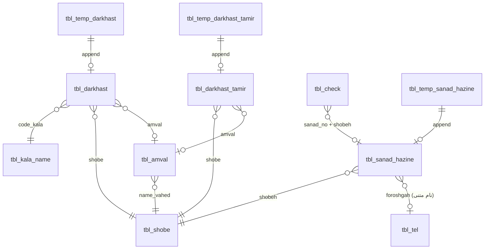

# بررسی ساختار فایل کارپردازی (accdb) — بدون پیاده‌سازی

> وضعیت: **فقط بررسی ساختار — طبق درخواست شما فعلاً کدی نوشته نمی‌شود**
> مبنای این سند: استخراج مستقیم ساختار داخلی فایل `کارپردازی مطهری 14030319_2.accdb`

---

## ۱. کشف مهم: معماری «دو فایلی» (Frontend / Backend)

ساختار فعلی برنامه یک‌فایلی **نیست**. طراحی فعلی از الگوی split-database اکسس استفاده می‌کند:

```
┌────────────────────────────────────────────────────────────┐
│  فایل موجود در گیت‌هاب (فرانت‌اند)                          │
│  کارپردازی مطهری 14030319_2.accdb                           │
│  ─ فرم‌ها، کوئری‌ها، کد VBA، جدول‌های موقت، چاپ‌ها          │
└──────────────────────────┬─────────────────────────────────┘
                           │ لینک ODBC/Access (مسیر شبکه)
                           ▼
┌────────────────────────────────────────────────────────────┐
│  فایل بک‌اند (روی شبکه داخلی — در گیت‌هاب موجود نیست)       │
│  \\10.9.0.3\gomrok\karpardazi\کارپردازی مطهری 14030319_be.accdb │
│  ─ همه جدول‌های اصلی و داده‌های واقعی                        │
└────────────────────────────────────────────────────────────┘
```

**نتیجه‌گیری‌های ساختاری:**
- فایل گیت‌هاب = «رابط کاربری + منطق»؛ داده‌ها در فایل `..._be.accdb` (be = backend) روی اشتراک شبکه `10.9.0.3` است.
- جدول‌های اصلی (Type=6 در MSysObjects) همگی **لینک‌شده**‌اند و فیزیکی در این فایل نیستند؛ به همین دلیل داده‌های رکوردها از این فایل قابل استخراج نیست.
- جدول‌های موقت (`tbl_temp_*`) داخل همین فایل (لوکال) ساخته شده‌اند و ساختارشان کامل قابل استخراج است (نمونه نزدیک به جدول‌های اصلی).
- برای **انتقال داده‌ها** به نسخه جدید، به فایل بک‌اند `_be.accdb` نیاز است (یا خروجی Excel از آن).

---

## ۲. ساختار جدول‌های اصلی (بک‌اند)

ستون‌ها از تعریف کوئری‌ها، فرم‌ها و جدول‌های موقت هم‌ساختار استخراج شده‌اند.
راهنمای نوع داده: تیپ‌های ستاره‌دار از روی جدول موقت هم‌نام **قطعی** است؛ بقیه از کاربردشان (SQL/فرم) استنباط شده‌اند.

### ۲.۱ tbl_darkhast — درخواست‌های خرید کالا/خدمات (مهم‌ترین جدول)

| ستون | نوع* | معنا |
|------|------|------|
| darkhastId | LONG ★ | شماره درخواست (سربرگ مشترک ردیف‌ها) |
| radif | LONG ★ | ردیف کالا/خدمت داخل درخواست |
| tarikh_darkhast | LONG ★ | تاریخ درخواست (شمسی عددی مثل ۱۴۰۳۰۳۱۹) |
| tarikh_kharid | LONG ★ | تاریخ خرید (۰ یعنی هنوز خریداری نشده) |
| shobe | TEXT ★ | شعبه (مطهری، مشهد، فرودگاه، …) |
| code_kala | LONG ★ | کد کالا ← ارجاع به tbl_kala_name |
| vahed | TEXT ★ | واحد سنجش |
| meghdar | LONG ★ | مقدار درخواستی |
| meghdar_mande | LONG ★ | مقدار باقی‌مانده (برای خریدهای ناقص) |
| ovlaviat | TEXT ★ | اولویت (عادی/فوری/…) |
| sharh | MEMO ★ | شرح کالا/خدمت |
| name_dastgah | TEXT ★ | نام دستگاه |
| noe_darkhast | TEXT ★ | نوع درخواست |
| amval | TEXT ★ | شماره اموال (در صورت نیاز) |
| erja | TEXT ★ | شماره ارجاع/نامه |
| entekhab | BOOLEAN | علامت‌گذاری برای خرید گروهی |

*تاریخ‌ها همه به‌صورت عدد شمسی ذخیره می‌شوند نه Date اکسس.*

### ۲.۲ tbl_darkhast_tamir — درخواست‌های تعمیر

`darkhastId`، `radif`، `shobe`، `name_dastgah`، `amval`، `tarikh_darkhast`، `tarikh_kharid`، `sharh`، `ovlaviat`، `erja`، `code_kala`

### ۲.۳ tbl_sanad_hazine — اسناد هزینه

| ستون | نوع* | معنا |
|------|------|------|
| sanad_no | LONG ★ | شماره سند |
| sanad_date | LONG ★ | تاریخ سند (شمسی عددی) |
| hazine_date | LONG ★ | تاریخ هزینه |
| sharh_hazine | TEXT ★ | شرح هزینه |
| mablagh | CURRENCY ★ | مبلغ (ریال) |
| maliat | CURRENCY ★ | مالیات |
| bime | CURRENCY ★ | بیمه |
| darvajh | TEXT | در وجه |
| shobeh | TEXT ★ | شعبه |
| foroshgah | TEXT ★ | فروشگاه/طرف حساب |

### ۲.۴ tbl_check — چک‌ها

| ستون | نوع* | معنا |
|------|------|------|
| sh_chek | TEXT ★ | شماره چک |
| mablagh | CURRENCY ★ | مبلغ چک |
| sabt_date | LONG | تاریخ ثبت (شمسی عددی) |
| sanad_no | LONG | ارجاع به سند هزینه |
| shobeh | TEXT ★ | شعبه |

### ۲.۵ جدول‌های مرجع (پایه)

| جدول | ستون‌ها | معنا |
|------|---------|------|
| **tbl_kala_name** | code_kala، kala_name، goroh، vahed | کالا/خدمت + گروه (لوازم و قطعات، مواد مصرفی ماشین‌آلات، لوازم اداری، …) |
| **tbl_shobe** | name_shobe | شعب: مطهری، مشهد، فرودگاه، لطف‌آباد، سرخس، دوغارون، نیشابور، گمرک |
| **tbl_amval** | sh_amval، name_amval، dastgah، mahal، name_vahed، tahvil_name | اموال: شماره/نام اموال، دستگاه، مکان، واحد، تحویل‌گیرنده |
| **tbl_tel** | ID، fname، lname، name_sherkat، name_foroshga، tel، mobile، code_meli، code_egh، code_posti، address، tozihat، group_name | مخاطبین (شخص/شرکت/فروشگاه) |
| **tbl_sharh_tamir** | sharh_tamir | شرح‌های آماده تعمیر |
| **tbl_sorathesab** | code_id، ghabz_id، sodor_date | صورت‌حساب/قبض |
| **tbl_tarefe** | code_asli، t_mablagh | تعرفه‌ها |
| **tbl_user** | ID، User، pass | کاربران (⚠ رمز به‌صورت ساده) |

> ⚠ جدول `tbl_sanad_hazine12` هم به‌صورت لینک‌شده وجود دارد (احتمالاً نسخه قدیمی/آزمایشی سند هزینه).

### ۲.۶ جدول‌های موقت (لوکال — داخل فایل فرانت‌اند)

این‌ها «سکوی ثبت گروهی» هستند: کاربر چند ردیف را موقتاً اینجا ثبت می‌کند، سپس کوئری Append آن‌ها را به جدول اصلی منتقل و جدول موقت را پاک می‌کند.

| جدول | ستون‌ها (تیپ‌ها قطعی است) | همتای اصلی |
|------|--------------------------|------------|
| tbl_temp_darkhast | darkhastId (LONG, PK)، erja (TEXT)، code_kala (LONG)، tarikh_kharid (LONG)، tarikh_darkhast (LONG)، sharh (MEMO)، amval (TEXT)، meghdar (LONG)، vahed (TEXT)، ovlaviat (TEXT)، shobe (TEXT)، name_dastgah (TEXT)، noe_darkhast (TEXT)، radif (LONG)، meghdar_mande (LONG) | tbl_darkhast |
| tbl_temp_darkhast_tamir | darkhastId (LONG, PK)، erja (LONG)، tarikh_kharid (LONG)، tarikh_darkhast (LONG)، sharh (MEMO)، amval (TEXT)، ovlaviat (TEXT)، shobe (TEXT)، name_dastgah (TEXT)، radif (LONG) | tbl_darkhast_tamir |
| tbl_temp_sanad_hazine | ID (LONG, PK)، sanad_date (LONG)، sharh_hazine (TEXT)، mablagh (CURRENCY)، sanad_no (LONG)، hazine_date (LONG)، shobeh (TEXT)، maliat (CURRENCY)، bime (CURRENCY)، foroshgah (TEXT) | tbl_sanad_hazine |

---

## ۳. روابط بین جدول‌ها (ER)

**نکته ساختاری مهم:** جدول روابط رسمی اکسس (`MSysRelationships`) **کاملاً خالی است** — یعنی هیچ Foreign Key یا Referential Integrity‌ای تعریف نشده؛ اتصال‌ها فقط داخل متن کوئری‌ها وجود دارند و یکپارچگی داده دستی است.



الگوهای پیوندی که در کوئری‌ها دیده می‌شود:
- `tbl_check.sanad_no = tbl_sanad_hazine.sanad_no` و `tbl_check.shobeh = tbl_sanad_hazine.shobeh`
- `tbl_kala_name` با `tbl_darkhast` روی `code_kala`
- `tbl_amval` با درخواست‌ها روی شماره اموال/نام دستگاه
- `((tbl_darkhast.entekhab)=True) AND ((tbl_darkhast.tarikh_kharid)=0)` ← الگوی «انتخاب‌شده‌ها برای ثبت گروهی خرید»

---

## ۴. ساختار فرم‌ها (صفحه‌های برنامه) — ۳۷ فرم

| گروه | فرم‌ها |
|------|--------|
| **ورود و شروع** | frm_start، frm_user (ورود)، frm_waiting (صفحه انتظار/بکاپ) |
| **صفحات اصلی** | frm_main (عملیات اصلی)، frm_main_edit (اصلاح)، frm_main_gozaresh (گزارشات)، frm_main_tarif (تعریف‌ها) |
| **درخواست خرید** | frm_pre_sabt_darkhast، frm_sabt_darkhast، frm_edit_darkhast، frm_sabt_kharid_kala (ثبت انجام خرید)، frm_sabt_multi_kharid (ثبت گروهی)، frm_sabt_entekhab، frm_mande_darkhast (مانده درخواست‌ها) |
| **درخواست تعمیر** | frm_pre_sabt_darkhast_tamir، frm_sabt_darkhast_tamir، frm_edit_darkhast_tamir |
| **سند هزینه** | frm_sabt_sanad_hazine، frm_edit_sanad_hazine، frm_list_sanad، frm_list_sanad_jam (جمع اسناد) |
| **چک** | frm_sabt_chek، frm_chek_edit، frm_chek_edit2، frm_sodor_chek (صدور/چاپ) |
| **اموال** | frm_sabt_amval_jadid (+ sub_frm_sabt_amval_jadid) |
| **کالا/شعبه** | frm_sabt_kala_jadid، frm_sabt_shobe |
| **مخاطبین** | frm_sabt_tel_ashkhas، frm_sabt_tel_sherkat، frm_show_tel، frm_list_tel، frm_list_tel1، frm_edit_tel |
| **گزارش/سایر** | frm_chart (نمودار)، Form1/Form2 (آزمایشی) |
| **زیرفرم‌ها** | ۱۴ زیرفرم (subform) برای نمایش ردیف‌های جدول‌ها داخل فرم‌های اصلی |

---

## ۵. ساختار کوئری‌ها (منطق برنامه) — ۱۵ کوئری اصلی

| کوئری | نقش ساختاری |
|-------|-------------|
| qry_append_tbl_darkhast | انتقال ردیف‌های tbl_temp_darkhast → tbl_darkhast (ثبت نهایی گروهی) |
| qry_append_tbl_darkhast_tamir | انتقال درخواست‌های تعمیر موقت → اصلی |
| qry_append_tbl_sanad | انتقال اسناد هزینه موقت → اصلی |
| qry_del_temp_tbl_darkhast / qry_del_temp_tbl_darkhast_tamir / qry_del_temp_sanad | پاک‌سازی جدول‌های موقت بعد از انتقال |
| qry_multi_sabt_kharid | ثبت گروهی خرید (روی رکوردهای entekhab=True و tarikh_kharid=0) |
| qry_sabt_check | درج چک جدید |
| qry_update_check | به‌روزرسانی چک |
| qry_sabt_hazine | درج سند هزینه |
| qry_sanad_jam | جمع‌بندی اسناد (Sum مبلغ/مالیات/بیمه) |
| qry_tbl_darkhast_kol | گزارش کل درخواست‌ها (Count/فیلتر بازه تاریخ و شعبه) |
| qry_tbl_hazine_cheak | گزارش تلفیقی هزینه و چک |
| qry_chart_darkhast | داده نمودار تعداد درخواست‌ها |
| qry_user | احراز هویت ورود |
| tbl_amval Query / Query1، tbl_darkhast Query / Query1 | کوئری‌های کمکی CRUD فرم‌ها |

به‌علاوه حدود ۵۰ کوئری سیستمی `~sq_c...` (کوئری منابع کمبو‌باکس‌های فرم‌ها).

**الگوی ثبت گروهی (ساختار تکرارشونده):**
```text
فرم ثبت → درج در tbl_temp_* → نمایش در زیرفرم → [ثبت نهایی]
   → qry_append_* (انتقال به جدول اصلی) → qry_del_temp_* (پاک‌سازی)
```

---

## ۶. نکات و ضعف‌های ساختاری فعلی (برای آگاهی در طراحی جدید)

| # | موضوع | توضیح | پیامد |
|---|--------|--------|--------|
| ۱ | **بدون رابطه رسمی (FK)** | MSysRelationships خالی است | امکان داده یتیم/نامعتبر؛ حذف کالا درخواست‌ها را نمی‌شکند ولی پیوندها خودکار چک نمی‌شوند |
| ۲ | **رمز عبور ساده** | tbl_user.pass متن ساده | ⚠ ریسک امنیتی |
| ۳ | **تکرار متنی شعبه** | نام شعبه در همه جدول‌ها TEXT تکراری (shobe/shobeh/name_vahed) | اگر نام شعبه عوض شود باید دستی همه‌جا اصلاح شود؛ غلط املایی = جدول جدا |
| ۴ | **تاریخ عددی شمسی** | tarikh_* به‌صورت LONG مثل 14030319 | محاسبات بازه/ترتیب دستی است؛ در نسخه جدید باید استاندارد شود |
| ۵ | **جدول اضافی tbl_sanad_hazine12** | نسخه قدیمی/آزمایشی | ابهام در مرجع بودن ساختار |
| ۶ | **وابستگی به IP ثابت شبکه** | بک‌اند روی \\10.9.0.3\... | با تغییر شبکه/مسیر همه‌چیز می‌شکند |
| ۷ | **بدون لاگ تغییرات** | هیچ جدول Audit نیست | پیگیری «چه کسی چه چیزی را عوض کرد» ممکن نیست |
| ۸ | **ستون‌های نامشخص کنسل/وضعیت** | دکمه «کنسل شده؟» در فرم هست ولی فیلد وضعیت مجزا دیده نشد | در طراحی جدید فیلد status صریح پیشنهاد می‌شود |
| ۹ | **حق دسترسی ندارد** | فقط ورود ساده؛ همه با یک سطح | در نسخه جدید نقش‌ها اضافه شود |

---

## ۷. پیشنهاد ساختار نرمال‌شده برای نسخه جدید (نقشه قدیم → جدید)

| جدول جدید | از کجا می‌آید | تغییرات |
|-----------|---------------|---------|
| branches | tbl_shobe | + کد یکتای شعبه (id) — نام دیگر در رکوردها تکرار نشود |
| goods (kala) | tbl_kala_name | + کد یکتا، پیوند گروه با جدول group |
| goods_groups | فیلد goroh | جدول مستقل |
| units | فیلد vahed (متن آزاد) | جدول مرجع + کد |
| requests (darkhast) | tbl_darkhast | سربرگ/ردیف جدا (requests + request_items)، status صریح، FK به branch/kala/unit |
| repairs | tbl_darkhast_tamir | + FK به assets، status صریح |
| expense_docs | tbl_sanad_hazine | + FK به branch/supplier، جمع کل محاسباتی |
| checks | tbl_check | + FK به expense_docs، مراحل تأیید (workflow status) |
| assets | tbl_amval | + FK به branch، تاریخچه جابجایی در جدول جدا (asset_moves) |
| contacts | tbl_tel | شخص/شرکت/فروشگاه با type به‌جای چند فیلد نام |
| suppliers | بخشی از tbl_tel (foroshgah) | تفکیک تأمین‌کننده از مخاطب عمومی |
| users + roles | tbl_user | هش رمز + نقش (مدیر/کارپرداز/مالی/فقط‌خواندنی) |
| audit_log | — (جدید) | چه کسی/چه/چه زمانی |
| attachments | پیوست‌های فرم‌ها (جدید) | الصاق فایل اسکن به درخواست/سند |

---

## ۸. جمع‌بندی

1. ساختار فعلی یک **سیستم کارپردازی دوفایلی اکسس** است: فرانت (فرم/منطق) + بک‌اند (داده) روی شبکه داخلی.
2. قلب سیستم جدول `tbl_darkhast` است با الگوی «سربرگ + ردیف» و «مقدار مانده» برای خریدهای ناقص.
3. ثبت گروهی با الگوی «جدول موقت → Append → پاک‌سازی» انجام می‌شود.
4. روابط رسمی وجود ندارد؛ تاریخ‌ها عدد شمسی‌اند؛ رمزها ساده‌اند — این‌ها در ساختار جدید اصلاح‌پذیرند.
5. **برای انتقال داده، فایل بک‌اند `..._be.accdb` لازم است** — لطفاً آن را هم در اختیار بگذارید (یا خروجی Excel جدول‌ها).

---

*مرتبط: [طرح پیشنهادی کلی](PROPOSAL-karperdazi.md) — فلوچارت‌ها و امکانات در آن سند است.*
